<div class="titlepage" markdown="1">

# Intrusion Detection and Prevention for IoT Networks on CICIoT2023

## Beating the benchmark honestly: leakage, timestamp proxies and a deployable prevention layer

**Capstone Project Report**

**Saksham Kala**

Enrolment No. E23CSEU1027

B.Tech Computer Science and Engineering (2023–2027)

Bennett University, Greater Noida

November 2026

</div>

<div class="pagebreak"></div>

## Abstract

IoT devices are easy targets for attacks such as floods, botnets and scanning. A machine-learning intrusion
detection system (IDS) learns to recognise these attacks from network-flow features. CICIoT2023 is a large public
benchmark for this task, and its authors (Neto et al., 2023) report Random Forest accuracies close to 99%.

In this project I trained 92 models (Random Forest, LightGBM, XGBoost, CatBoost, an MLP, focal-loss
XGBoost and a hierarchical classifier) and tried 20 post-hoc variants (threshold tuning, calibration,
ensembles), choosing all final results on a validation split, not on the test split.

- On the **full 39-feature release** (46,775,660 rows) I beat the paper's 8-class macro-F1
  (0.7308 vs 0.7193) but not its 2-class accuracy (0.9937 vs 0.9968)
  or 34-class macro-F1 (0.6452 vs 0.7140).
- On a **46-feature subset** that matches the paper's feature table I beat all three targets
  (0.9977, 0.8925, 0.8484). However, one feature, **IAT**, behaves like a capture
  timestamp: a small tree on IAT alone gets 0.9905 8-class accuracy. Without IAT the 2-class target is not met,
  8-class macro-F1 is 0.7547 and 34-class macro-F1 ties the paper (0.7143 vs 0.7140).
- The paper-style shuffled split has **59.05% duplicate rows** between train and test, and a
  file-grouped split lowers 8-class macro-F1 by 0.2751. **DoS vs DDoS** confusion causes 95.13%
  of 8-class errors.
- Finally, I built an **intrusion prevention layer (IDPS)** on the no-IAT model. It chooses the right action
  for 0.99448 of 200,000 unseen flows, blocks 2.65% of benign flows, misses 0.29% of
  attacks and needs 1.46 ms per flow on a CPU.

<div class="pagebreak"></div>

## 1. Introduction

The Internet of Things (IoT) connects cameras, plugs, sensors and speakers to home and office networks. These
devices often have weak passwords and old software, so attackers use them to launch floods (DoS and DDoS), build
botnets (Mirai), scan networks (reconnaissance), fake identities (spoofing) and attack web services.

An **intrusion detection system (IDS)** watches the traffic and raises an alarm when it sees an attack. A
machine-learning IDS learns this from labelled examples. Each example is a *flow*: a short window of packets
summarised by numbers such as packet sizes, flag counts and rates.

**CICIoT2023** (Neto et al., 2023) is one of the largest public datasets for this. It was captured from 105 real
IoT devices and covers 33 attacks plus benign traffic. Labels come at three levels of detail:

- **2-class:** benign or attack
- **8-class:** Benign, DDoS, DoS, Mirai, Recon, Spoofing, Web-based, Brute-force
- **34-class:** each individual attack

The authors' Random Forest results are the targets for this project:

| Task | Paper accuracy | Paper F1 |
|---|---|---|
| 2-class | 0.9968 | 0.9653 |
| 8-class | 0.9944 | 0.7193 |
| 34-class | 0.9916 | 0.7140 |

(Source: Neto et al. 2023, Table 6. The paper does not say how its F1 is averaged; I compare against my macro-F1.)

A **prevention system (IDPS)** goes one step further than an IDS: it also acts, for example by blocking or
rate-limiting the attacker.

## 2. Objectives

1. Reproduce and try to beat the published results for 2, 8 and 34 classes, **honestly**: final models, thresholds
   and features are chosen on validation, not on the test set.
2. Find out *why* the published numbers are hard to reproduce, and prove each finding with numbers and figures.
3. Check whether the 8 features missing from our dataset version explain the gap.
4. Build a working prevention layer (IDPS) on top of the best *deployable* model, with a live demo.

## 3. Dataset

### 3.1 Two versions of CICIoT2023

**Full release (39 features).** The public CSV release I used has 309 files (one or more per attack) in 34
folders, with **46,775,660 rows** and **39 numeric features**. It is missing 8 of the 46 features
listed in the paper (flow_duration, Srate, Drate, urg_count, Magnitue, Radius, Covariance, Weight) and has one
extra (IGMP).

**46-feature subset (Kaggle).** I could not find a 46-feature copy of the full release. A `MERGED_CSV` copy I
checked also had only 39 features. So for the 46-feature experiments I used a public Kaggle subset
(`himadri07/ciciot2023`) with **7,845,673 rows** after merging its train, validation and test files. It is a
**subset**, not the full release, so numbers on the two versions are not directly comparable.

### 3.2 Class counts

| 8-class label | Full release (39 feat.) | Kaggle subset (46 feat.) |
|---|---|---|
| Benign | 1,098,126 | 184,766 |
| Brute_Force | 13,064 | 2,150 |
| DDoS | 33,983,922 | 5,712,004 |
| DoS | 7,844,894 | 1,358,351 |
| Mirai | 2,633,870 | 442,608 |
| Recon | 690,521 | 59,444 |
| Spoofing | 486,435 | 82,246 |
| Web_Based | 24,828 | 4,104 |
| Total (2-class: Benign / Attack) | 46,775,660 (1,098,126 / 45,677,534) | 7,845,673 (184,766 / 7,660,907) |

*Rows per 8-class label in the two dataset versions used. 34-class counts are listed in the appendix of the report.*

The data is very imbalanced: DDoS dominates, while Brute_Force and Web_Based have only a few thousand rows.
This is why I use **macro-F1** (the average F1 over classes, so every class counts equally) as the main metric
for 8 and 34 classes. Accuracy alone would mostly measure DDoS.

The full 34-class counts are in Appendix D.

## 4. Methodology

### 4.1 Splitting the data

- **Full release (v1–v3):** shuffled rows, split 75% train / 5% validation / 20% test with seed 42
  (train 35,086,364, validation 2,339,084, test 9,350,212 rows). No duplicates were removed, to match the
  paper.
- **Kaggle subset (v4):** the paper's protocol. Shuffle, split 80% train / 20% test with seed 42, then take 5% of
  the training part as validation (train 5,962,711, validation 313,827, test 1,569,135 rows).

The **validation split** is used for early stopping, model selection and tuning thresholds. The **test split**
is scored once per reported model.

All final reported results (v3 final ensembles, the 8-class XGBoost balanced_deep, and v4) were selected on validation only. Some early exploration runs (v1–v2, e.g. picking `xgboost_balanced_p050` among 34-class models) ranked candidates by test macro-F1; we report this as a limitation.

### 4.2 Preprocessing

- No missing or infinite values were found.
- In v4, a StandardScaler is fitted on the training part only and then applied to validation and test.
- Labels are mapped to 2, 8 and 34 classes with one fixed mapping file
  (`src/preprocessing/class_maps.json`).

### 4.3 Handling class imbalance

Rare classes get bigger sample weights: `w_c = (N / (k · n_c))^p`, where `n_c` is the class size and `k` the
number of classes. I use `p = 0.5` ("square-root weights") by default and test `p = 0`, `0.25` and `0.5` in N6.
CatBoost uses its built-in `Balanced` option, and one Random Forest uses `balanced_subsample`.

### 4.4 Models

| Model | Why it was tried |
|---|---|
| Random Forest (200 trees) | The paper's own method, for a direct comparison |
| LightGBM (CPU, 16 threads) | Fast, strong gradient boosting for tabular data |
| XGBoost 2.1.4 on GPU | Strong boosting; the GPU makes training on tens of millions of rows practical |
| CatBoost on GPU | A third boosting library with built-in class balancing |
| MLP (1024-512-256) | To check whether a neural network helps on tabular data |
| Focal-loss XGBoost | Focuses training on hard, rare examples |
| Hierarchical 8→34 | First predicts the family, then the exact attack |

**Post-hoc methods** (applied to already-trained models, tuned on validation):

- **A1 threshold tuning:** multiply each class's probability by a factor before taking the maximum.
- **A2 calibration:** isotonic and sigmoid (Platt) calibration.
- **A3 ensembles:** soft voting, weighted voting and a stacked meta-model.

### 4.5 Choosing the best model

- 2-class: highest **validation accuracy** (the paper's 2-class headline metric).
- 8 and 34 classes: highest **validation macro-F1**.
- The best full-release models were re-trained with seeds 42, 123 and 456 to check stability.

### 4.6 Tools and hardware

Python, scikit-learn 1.9.1, XGBoost 2.1.4, LightGBM 4.7.0, CatBoost 1.2.10 and PyTorch, on a DGX server with
NVIDIA H200 GPUs and 224 CPU cores. Large files were kept in `/dev/shm` (RAM disk) because the home disk was small.

## 5. Experiments in time order

### 5.1 v1: first benchmark (full release)

**What:** XGBoost and LightGBM with three configs each (cfg1: depth-wise; cfg2: wide and loss-guided; cfg3: cfg2
plus class weights), CatBoost and an MLP, for all three tasks. The training script went through three
engineering versions (`phase2_train.py`, `phase2_train_v2.py`, `phase2_train_v3.py`) that changed only the
hardware set-up and run order: XGBoost 3.x could not use the GPU with the installed driver, so I moved to 2.1.4,
and LightGBM became much slower with more than 64 threads because of NUMA effects, so I limited it to 16 threads.

**Result:** the class-weighted XGBoost and LightGBM configs (cfg3) both passed the 8-class macro-F1 target of
0.7193. 2-class accuracy and 34-class macro-F1 stayed below the targets (all scores are in
Appendix B).

### 5.2 v2: closing the gap and asking why (full release)

**What changed and why:** since 2-class and 34-class were short, I tried deeper and balanced XGBoost, the paper's
Random Forest, training on train+validation (to use 80% of the data like the paper), an "accuracy push" with
very deep or wide trees, threshold optimisation and a soft-vote ensemble. When none of these closed the gap, I
started asking whether the *evaluation* was the problem, which led to the analyses N1–N6 (Section 7) and a
3-seed check of the best models.

**Result:** every 2-class strategy converged to about the same accuracy (best single model
0.9938 averaged over 3 seeds). For 8-class, the deeper class-weighted XGBoost (balanced_deep) has the
highest validation macro-F1 of all models, so it is the final 8-class model: test macro-F1 0.7308 vs
0.7193 for the paper. The analyses showed heavy duplication and file-level leakage (N1, N2).

### 5.3 v3: new methods on top (full release)

**What:** post-hoc threshold tuning, calibration and stacking; CatBoost on GPU with several settings;
focal-loss XGBoost; and a hierarchical 8→34 classifier.

**Result:** post-hoc methods changed test macro-F1 only slightly (Table 6). The final 2-class result is
0.9937 accuracy and the final 34-class result is 0.6452 macro-F1. CatBoost, focal
and hierarchical models were all worse than flat XGBoost (N6).

### 5.4 v4: the paper's 46 features (Kaggle subset)

**What changed and why:** our release lacked 8 of the paper's features, so I tested whether they explain the
gap. On the same rows of the 46-feature subset, with the paper's 80/20 protocol, I trained each model with
38 features (the 46 minus the 8 paper-only ones) and with all 46: RF-200, XGBoost with the best earlier
configs, and one unweighted XGBoost per task. A single-feature check then showed that IAT alone almost solves
the task, so I added runs **without IAT** (30 runs in total).

**Result:** with 46 features every target is beaten, but 38 features do almost as well, so the 8 features are
*not* the reason. The real reason is IAT (N4).

### 5.5 IDPS: from detection to prevention

**What:** a policy maps each 8-class prediction to an action, BLOCK actions generate firewall rules, and a
simulator and live demo run on unseen test flows (Section 8).

## 6. Results

### 6.1 Best model per task vs the paper

| Setting | Task | Model | Test acc | Test mF1 | Paper acc / F1 | Δ (judged metric) | Verdict |
|---|---|---|---|---|---|---|---|
| Full release, 39 features (v1-v3) | 2-class | Stacked ensemble + threshold (v3) | 0.9937 | 0.9339 | 0.9968 / 0.9653 | acc -0.0031 | NOT BEAT |
| Full release, 39 features (v1-v3) | 8-class | XGBoost balanced_deep (v2) | 0.8415 | 0.7308 | 0.9944 / 0.7193 | mF1 +0.0115 | **BEAT** |
| Full release, 39 features (v1-v3) | 34-class | XGBoost balanced_p050 + per-class thresholds (v3) | 0.7895 | 0.6452 | 0.9916 / 0.7140 | mF1 -0.0688 | NOT BEAT |
| Kaggle subset, 46 features (v4) | 2-class | Random Forest (200 trees) | 0.9977 | 0.9754 | 0.9968 / 0.9653 | acc +0.0009 | **BEAT** |
| Kaggle subset, 46 features (v4) | 8-class | XGBoost (prior best config) | 0.9967 | 0.8925 | 0.9944 / 0.7193 | mF1 +0.1732 | **BEAT** |
| Kaggle subset, 46 features (v4) | 34-class | XGBoost (prior best config) | 0.9957 | 0.8484 | 0.9916 / 0.7140 | mF1 +0.1343 | **BEAT** |
| Kaggle subset, 46 features, no IAT (v4) | 2-class | XGBoost (prior best config) | 0.9959 | 0.9562 | 0.9968 / 0.9653 | acc -0.0009 | NOT BEAT |
| Kaggle subset, 46 features, no IAT (v4) | 8-class | XGBoost (prior best config) | 0.9154 | 0.7547 | 0.9944 / 0.7193 | mF1 +0.0354 | **BEAT** |
| Kaggle subset, 46 features, no IAT (v4) | 34-class | XGBoost (prior best config) | 0.8976 | 0.7143 | 0.9916 / 0.7140 | mF1 +0.0003 | **BEAT** |

*Best model per task against Neto et al. 2023 (RF, Table 6). 2-class is judged on accuracy, 8- and 34-class on macro-F1. Δ = ours minus paper. All rows were selected on validation.*

**How to read this:** on the full release I beat the paper only on 8-class. On the 46-feature subset all three
are beaten, but once IAT is removed, 2-class falls below the paper and 34-class only ties it.

### 6.2 v4 ablation: 38 vs 46 features, with and without IAT

| Task (judged on) | 38 feat. | 46 feat. | 38 feat., no IAT | 46 feat., no IAT | Paper RF |
|---|---|---|---|---|---|
| 2-class (acc) | 0.9972 / 0.9696 (BEAT) | 0.9977 / 0.9754 (BEAT) | 0.9947 / 0.9436 (NOT) | 0.9959 / 0.9562 (NOT) | 0.9968 / 0.9653 |
| 8-class (mF1) | 0.9961 / 0.8799 (BEAT) | 0.9967 / 0.8925 (BEAT) | 0.9076 / 0.7346 (BEAT) | 0.9154 / 0.7547 (BEAT) | 0.9944 / 0.7193 |
| 34-class (mF1) | 0.9951 / 0.8361 (BEAT) | 0.9957 / 0.8484 (BEAT) | 0.8900 / 0.6979 (NOT) | 0.8976 / 0.7143 (BEAT) | 0.9916 / 0.7140 |

*v4 ablation on the same rows of the Kaggle subset (80/20 + 5% val, seed 42). Cells: test accuracy / test macro-F1 of the model selected on validation; BEAT/NOT against the paper on the judged metric.*

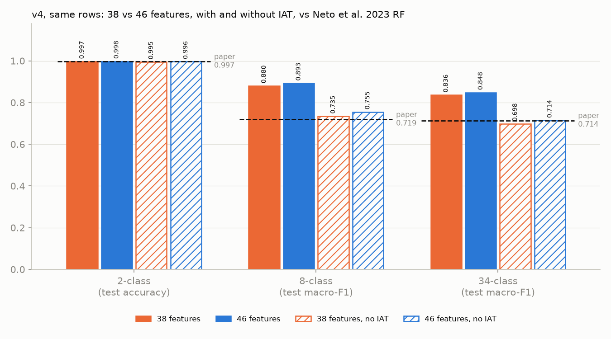

*Figure 1. v4 results on the same rows. Solid bars use IAT and hatched bars do not; the dashed line is the paper.
Source: `results/v4_46feat/summary.json`.*

### 6.3 Stability over seeds

| Task | Model | Seeds | Test acc (mean ± std) | Test mF1 (mean ± std) |
|---|---|---|---|---|
| 2-class | lightgbm_cfg2 | 42, 123, 456 | 0.9938 ± 0.000003 | 0.9328 ± 0.000030 |
| 8-class | xgboost_balanced_deep | 42, 123, 456 | 0.8415 ± 0.000124 | 0.7309 ± 0.000055 |
| 34-class | xgboost_balanced_p050 | 42, 123, 456 | 0.7945 ± 0.000073 | 0.6434 ± 0.000157 |
| 34-class | hierarchical 8→34 (hard) | 1, 2, 42 | 0.7714 ± 0.000051 | 0.6352 ± 0.000102 |
| 2-class | CatBoost c1, no weights | 1, 2, 42 | 0.9927 ± 0.000045 | 0.9223 ± 0.000673 |
| 34-class | CatBoost c1, no weights | 1, 2, 42 | 0.7749 ± 0.000054 | 0.5408 ± 0.001091 |

*Multi-seed results on the full release. Std is the population std over seeds; BEST rows from results/{task}_class/BEST/multi_seed_results.json, others computed from the per-seed JSONs.*

The standard deviations are tiny (at most 0.000157), so the differences between models are real
and not luck.

### 6.4 Post-hoc methods

| Ver | Task | Method | Val mF1 (selection) | Test acc | Test mF1 |
|---|---|---|---|---|---|
| v2 | 2 | LightGBM cfg2 + threshold 0.49 | n/a | 0.9937 | 0.9324 |
| v2 | 2 | Soft-vote ensemble (3 models) | n/a | 0.9938 | 0.9332 |
| v3 | 2 | baseline | 0.9323 | 0.9938 | 0.9328 |
| v3 | 2 | A1_threshold | 0.9328 | 0.9937 | 0.9333 |
| v3 | 2 | A2_isotonic | 0.9315 | 0.9938 | 0.9329 |
| v3 | 2 | A2_sigmoid | 0.9253 | 0.9934 | 0.9257 |
| v3 | 2 | A3_soft | 0.9316 | 0.9937 | 0.9322 |
| v3 | 2 | A3_weighted | 0.9316 | 0.9937 | 0.9322 |
| v3 | 2 | A3_weighted+A1 | 0.9320 | 0.9936 | 0.9328 |
| v3 | 2 | A3_stack | 0.9325 | 0.9938 | 0.9334 |
| v3 | 2 | A3_stack+A1 (selected by val) | 0.9332 | 0.9937 | 0.9339 |
| v3 | 34 | baseline | 0.6412 | 0.7946 | 0.6429 |
| v3 | 34 | A1_threshold (selected by val) | 0.6431 | 0.7895 | 0.6452 |
| v3 | 34 | A2_isotonic | 0.6361 | 0.7980 | 0.6380 |
| v3 | 34 | A2_sigmoid | 0.6369 | 0.7980 | 0.6386 |
| v3 | 34 | A3_soft | 0.6394 | 0.7955 | 0.6416 |
| v3 | 34 | A3_weighted | 0.6402 | 0.7953 | 0.6426 |
| v3 | 34 | A3_weighted+A1 | 0.6423 | 0.7888 | 0.6461 |
| v3 | 34 | A3_stack | 0.6367 | 0.7981 | 0.6398 |
| v3 | 34 | A3_stack+A1 | 0.6423 | 0.7901 | 0.6480 |

*Post-hoc methods on the full release (threshold tuning A1, calibration A2, ensembles and stacking A3). The method is chosen by validation macro-F1 only.*

### 6.5 Confusion matrices and per-class F1

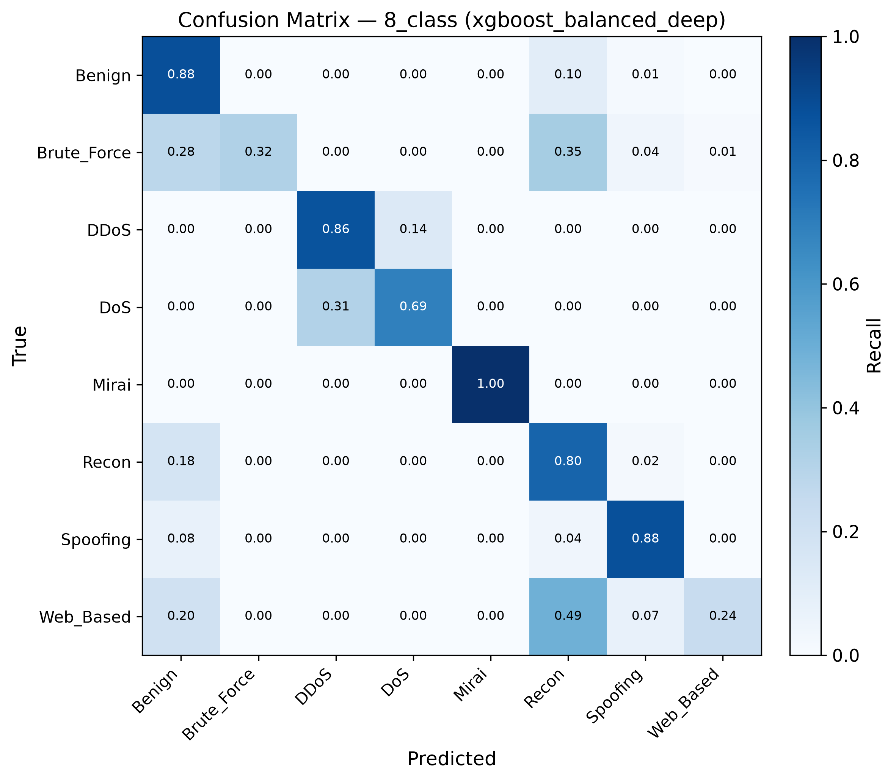

*Figure 2. 8-class confusion matrix of the best full-release model on validation (XGBoost balanced_deep). The big
off-diagonal cells are DDoS↔DoS. Source: `results/8_class/xgboost_balanced_deep/results.json`.*

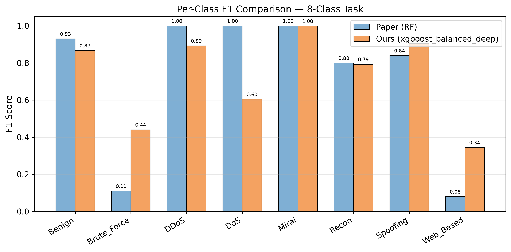

*Figure 3. Per-class F1, 8-class, full release. Brute_Force, DoS and Web_Based are the weak classes.*

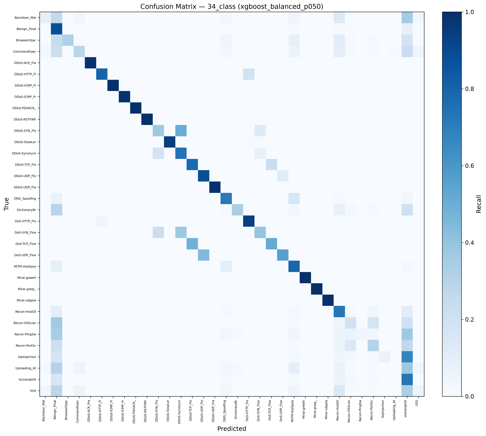

*Figure 4. 34-class confusion matrix of XGBoost balanced_p050. Decision D24 ranked it first on test macro-F1; it also
has the highest validation macro-F1 recorded for any 34-class single model (0.6412).
Source: `results/34_class/xgboost_balanced_p050/results.json`.*

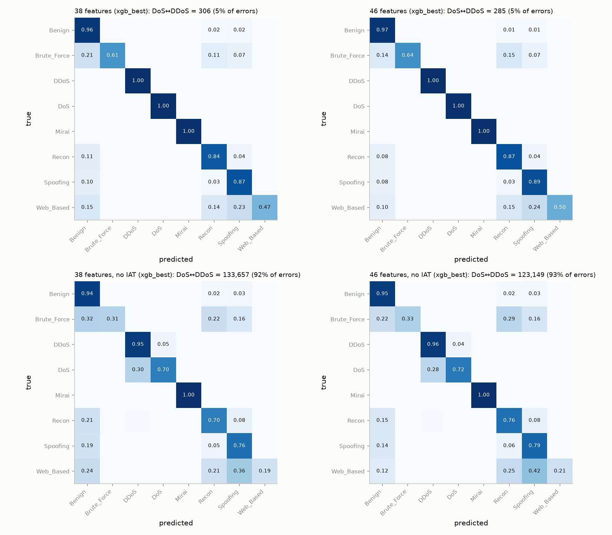

*Figure 5. v4 8-class confusion matrices with and without IAT. Without IAT, DoS↔DDoS confusion comes back.*

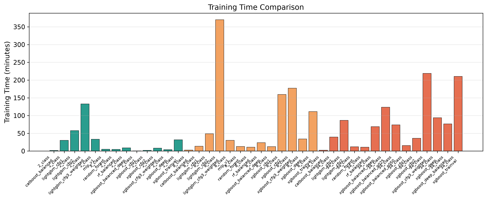

*Figure 6. Training time per model (full release, v1/v2).*

The table of **every** trained model, with config, validation and test scores and training time, is in
Appendix B.

## 7. Novelties, each with its proof

| Analysis | Measure | Value | Evidence (JSON) |
|---|---|---|---|
| N1 twins | test rows with an exact train twin | 59.05% (full) / 5.61% (v4) | results/novelty/N1_twin_analysis/results.json; results/v4_46feat/summary.json |
| N2 protocol ladder | 8-class mF1: paper protocol → file-grouped (twin-free) | 0.7308 → 0.4454 (0.4557) | results/novelty/N2_protocol_ladder/results.json |
| N3 DoS vs DDoS | share of 8-class test errors (full / v4 no-IAT) | 95.13% / 92.82% | results/novelty/v3/dos_ddos_balanced_deep.json; results/v4_46feat/summary.json |
| N3 merge | 8-class acc → 7-class (DoS+DDoS merged) acc | 0.8415 → 0.9923 | results/novelty/v3/dos_ddos_balanced_deep.json |
| N4 IAT | IAT-only depth-8 tree, 8-class val acc (majority baseline) | 0.9905 (0.7278) | results/v4_46feat/iat_probe.json |
| N5 window | capture-window classifier accuracy | 99.9997% | results/novelty/N5_window_size/results.json |
| N6 hierarchical | 34-class test mF1, hierarchical (3 seeds) vs flat | 0.6352 vs 0.6429 | results/novelty/v3/hierarchical_s*.json |

*Summary of the analyses N1-N6 with their evidence files.*

### N1. Twin leakage: the test set contains copies of the training set

**Finding:** under the shuffled split, **59.05%** of full-release test rows have an exact duplicate
("twin") in the training set: 67.61% for DDoS but only 0.54% for benign. In the v4 subset only
5.61% of test rows have a twin.

**Proof:** `results/novelty/N1_twin_analysis/results.json`, `results/v4_46feat/summary.json`, Figure 7.

| 8-class label | Test rows with exact train twin |
|---|---|
| DDoS | 67.61% |
| DoS | 55.52% |
| Mirai | 9.26% |
| Spoofing | 7.06% |
| Recon | 1.33% |
| Web_Based | 0.79% |
| Benign | 0.54% |
| Brute_Force | 0.23% |

*N1: twin rate per class on the full release (75/5/20 split).*

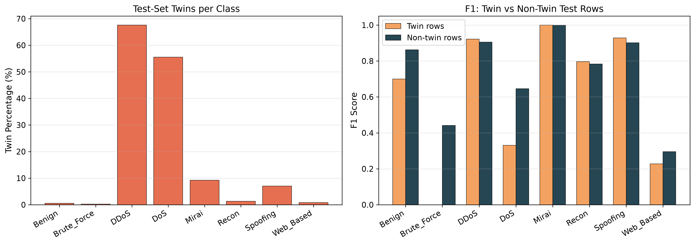

*Figure 7. Twin share per class and F1 on twin vs non-twin rows.*

### N2. Protocol ladder: the split decides the score

**Finding:** keeping the model fixed, 8-class macro-F1 is 0.7308 with the paper protocol and
0.7297 after de-duplication, but drops to **0.4454** when whole capture files are kept on one side
(0.4557 if also twin-free). That is a fall of 0.2751.

**Proof:** `results/novelty/N2_protocol_ladder/results.json`, Figure 8.

| Protocol (8-class, XGBoost balanced_deep) | Test acc | Test mF1 |
|---|---|---|
| (a) paper protocol: shuffled rows, no de-dup | 0.8415 | 0.7308 |
| (b) + de-duplication | 0.8572 | 0.7297 |
| (c) file-grouped split | 0.7455 | 0.4454 |
| (d) file-grouped + twin-free | 0.7217 | 0.4557 |

*N2: protocol ladder on the full release.*

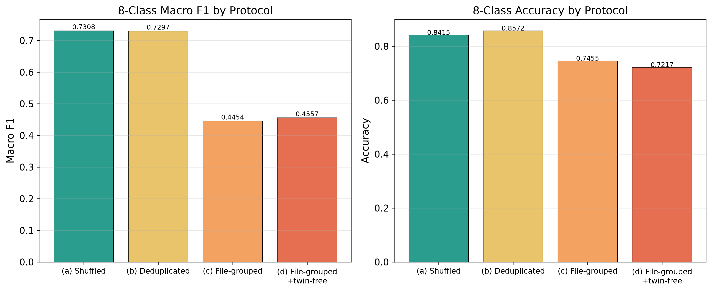

*Figure 8. 8-class macro-F1 and accuracy under four evaluation protocols.*

### N3. DoS vs DDoS is the bottleneck

**Finding:** **95.13%** of all 8-class test errors on the full release are DoS↔DDoS confusions.
Re-scoring the *same* predictions with the two merged raises accuracy from 0.8415 to
**0.9923**. In v4 the confusion is 5.47% of errors with IAT but **92.82%**
without it, and the 8 extra features do not fix it (133,657 confusions with 38 features and no IAT).

**Why:** a flood from one source and a flood from many sources look the same flow by flow. The difference only
shows up in the overall traffic.

**Proof:** `results/novelty/v3/dos_ddos.json`, `results/v4_46feat/summary.json`, Figure 9.

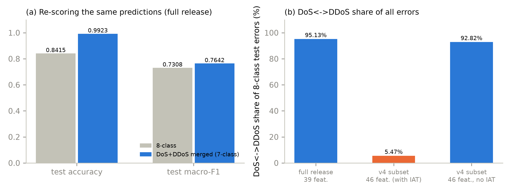

*Figure 9. (a) Merging DoS and DDoS on the same predictions; (b) DoS↔DDoS share of errors.*

### N4. IAT acts as a capture timestamp

**Finding:** in the 46-feature subset, the median raw IAT is 8.295e+07 for DoS-TCP_Flood,
8.313e+07 for DDoS-ICMP_Flood and 1.665e+08 for benign traffic, and each attack sits in its own
narrow band. These are not plausible "time since the previous packet" values; they behave like a clock reading
from when the attack was captured. A single depth-8 tree using **only IAT** reaches **0.9905** 8-class
validation accuracy (majority class: 0.7278; next best feature, Min: 0.8111). IAT
carries 39.55% of the importance in the 46-feature 8-class model. Without IAT, 8-class accuracy falls
from 0.9967 to 0.9154.

**Contrast:** on the full release, removing TTL and IAT changed 2-class accuracy by only 0.000532, so the
proxy belongs to this data version.

**Proof:** `results/v4_46feat/iat_probe.json`, `results/v4_46feat/summary.json`, Figures 10–11.

| Raw label (Kaggle) | IAT 1st pct | IAT median | IAT 99th pct |
|---|---|---|---|
| DoS-TCP_Flood | 8.293e+07 | 8.295e+07 | 8.296e+07 |
| DoS-SYN_Flood | 8.297e+07 | 8.298e+07 | 8.299e+07 |
| DoS-UDP_Flood | 8.3e+07 | 8.301e+07 | 8.303e+07 |
| DDoS-TCP_Flood | 8.303e+07 | 8.307e+07 | 8.308e+07 |
| DDoS-SYN_Flood | 8.308e+07 | 8.309e+07 | 8.35e+07 |
| DDoS-ICMP_Flood | 8.312e+07 | 8.313e+07 | 8.348e+07 |
| Mirai-greeth_flood | 8.368e+07 | 8.368e+07 | 8.37e+07 |
| BenignTraffic | 7.46e-05 | 1.665e+08 | 1.665e+08 |
| DNS_Spoofing | 3.6e-06 | 1.669e+08 | 1.669e+08 |
| XSS | 0.0001907 | 1.676e+08 | 1.676e+08 |

*N4: per-class IAT quantiles in the Kaggle subset (selected classes; all 34 in results/v4_46feat/iat_probe.json).*

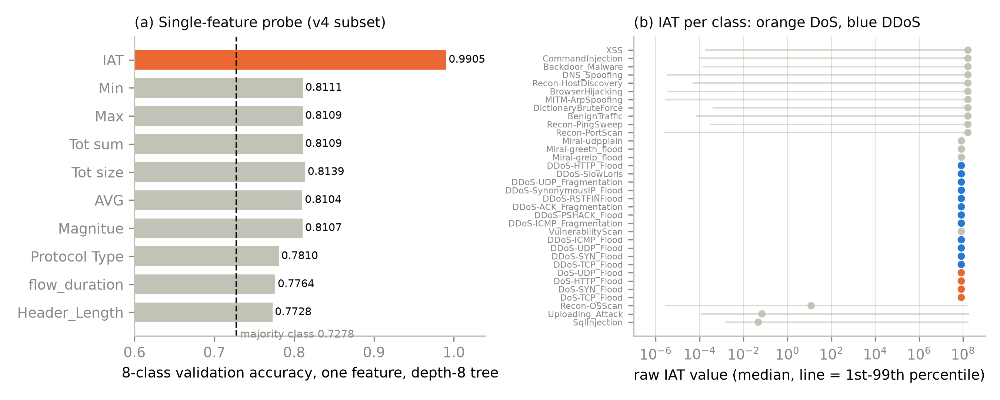

*Figure 10. (a) Accuracy of a one-feature tree for each feature; (b) IAT range per class.*

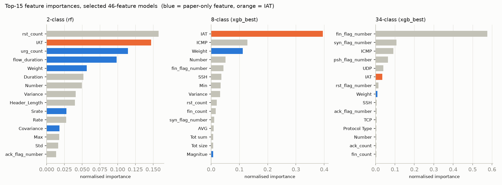

*Figure 11. Top-15 feature importances of the 46-feature models (orange = IAT, blue = paper-only features).*

### N5. Window-size artifact

**Finding:** the dataset averages packets over windows of 10 or 100 packets. A classifier can tell which window
a row came from with **99.9997%** accuracy. Removing the window-related features changes 8-class
macro-F1 by -0.0184.

**Proof:** `results/novelty/N5_window_size/results.json`.

### N6. Negative results: hierarchical, CatBoost, focal

**Finding:** the hierarchical 8→34 model reaches 0.6352 ± 0.000102 34-class macro-F1 over 3 seeds,
below flat XGBoost (0.6429). Telling subtypes apart *within* a family is easy; the errors come from
choosing the wrong family. The best CatBoost GPU run gives 0.5417 and focal reweighting gives
0.5152. In the class-weight sweep, power 0.25 is best for 8-class (0.7285).

**Proof:** `results/novelty/v3/hierarchical_s{1,2,42}.json`, `results/34_class/v3/catboost/`,
`results/34_class/v3/focal/`, `results/novelty/N6_class_weight_sweep/results.json`, Figure 12.

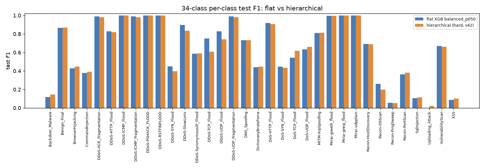

*Figure 12. 34-class per-class F1, flat vs hierarchical.*

### N7. The benchmark paper used IAT

**Finding:** Table 4 of Neto et al. (2023), "Features extracted from the network traffic", lists IAT and
describes it as *"The time difference with the previous packet"*. The paper's cleaning step says: *"In our
experiments, we only remove the timestamp from the list since it does not illustrate the network behavior"*.
So only the `ts` (timestamp) column was removed, and **IAT stayed in**. Given N4, the paper's ~99% accuracies
probably depend partly on this capture-time proxy.

Feature list quoted from the paper (Table 4, exactly as rendered in the PubMed Central copy, where three names
appear truncated):

> ts, flow duration, Header Length, Protocol Type, Duration, Rate, Srate, Drate, fin flag number, syn flag
> number, rst flag number, psh flag numbe [sic], ack flag number, ece flag numbe [sic], cwr flag number, ack
> count, syn count, fin count, urg coun [sic], rst count, HTTP, HTTPS, DNS, Telnet, SMTP, SSH, IRC, TCP, UDP,
> DHCP, ARP, ICMP, IPv, LLC, Tot sum, Min, Max, AVG, Std, Tot size, IAT, Number, Magnitude, Radius,
> Covariance, Variance, Weight
> — Neto et al. 2023, Table 4

**Note:** I could not run the authors' code, so this is an inference from their stated pipeline plus my
measurements.

## 8. Intrusion Prevention (IDPS)

### 8.1 Policy

| 8-class label | Action |
|---|---|
| Benign | ALLOW |
| DDoS | BLOCK |
| DoS | BLOCK |
| Mirai | BLOCK |
| Recon | ALERT |
| Spoofing | BLOCK+ALERT |
| Web_Based | BLOCK+ALERT |
| Brute_Force | BLOCK+ALERT |

*IDPS policy (src/prevention/policy.json).*

DoS and DDoS share one action on purpose, since they are the pair the model confuses most. BLOCK writes an
`iptables` rate-limit rule (hashlimit, drop above 100 packets/second per source). BLOCK+ALERT writes a full drop
rule and raises an alert. ALERT only raises an alert.

### 8.2 Results on 200,000 unseen test flows

| Measure | Value |
|---|---|
| Plain 8-class accuracy | 0.91522 |
| **Action accuracy** (right action for the true class) | **0.99448** |
| Class errors that still got the right action | 15,852 of 16,956 (15,758 are DoS↔DDoS) |
| False block rate (benign flows blocked) | 2.65% (124 flows) |
| Miss rate (attack flows allowed) | 0.29% (567 flows) |
| Latency, one flow at a time (CPU) | 1.46 ms average, 4.10 ms p99 |
| Latency, batch of 1000 (per flow) | 0.0363 ms average, 0.0424 ms p99 |

| Action | Precision | Recall | Support | Taken |
|---|---|---|---|---|
| ALLOW | 0.8873 | 0.9531 | 4,686 | 5,033 |
| BLOCK | 0.9999 | 0.9999 | 191,526 | 191,517 |
| ALERT | 0.8034 | 0.7418 | 1,526 | 1,409 |
| BLOCK+ALERT | 0.8775 | 0.7918 | 2,262 | 2,041 |

*IDPS per-action precision and recall on 200,000 test flows.*

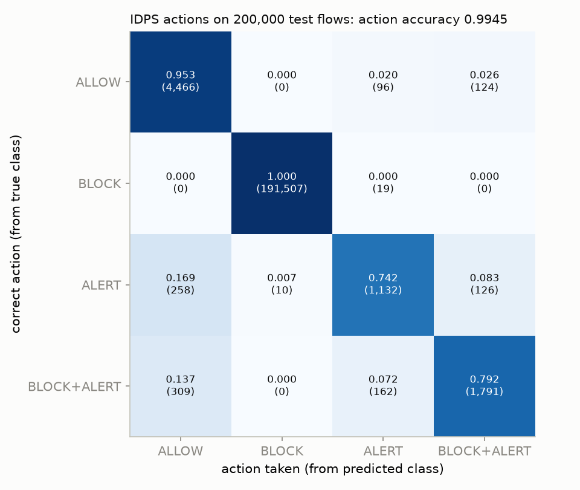

*Figure 13. Correct action vs action taken. Source: `results/prevention/summary.json`.*

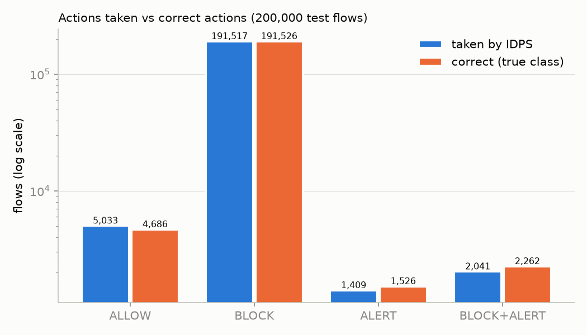

*Figure 14. How often each action was taken, compared with how often it should have been.*

**Important notes:**

- **Blocking is simulated.** CICIoT2023 has no IP addresses, so rules use placeholder IPs from the
  documentation range 203.0.113.0/24. They are generated as text and never executed.
- **The deployed model excludes IAT** because of the timestamp leak (N4).

### 8.3 How to run the demo

```bash
cd src/prevention
python train_model.py 0     # only if /dev/shm/saksham/v4/prevention/ has no model (argument = GPU id)
python idps_simulator.py    # 200k-flow simulation -> results/prevention/, figures/prevention/
python demo.py              # live demo: one coloured line per flow + running counters
python demo.py --attacks-only --delay 0.3 --rows 200   # fewer DDoS rows, so rarer attacks show up
```

The demo runs on a CPU with only the packages in `requirements.txt`. It reads 2,000 test flows from
`results/prevention/demo_flows.csv` and the model from `/dev/shm/saksham/v4/prevention/` (change this with
`--model-dir`).

## 9. Discussion

A model that wins by reading IAT is really reading **when** the attack was recorded. On a real network, attacks
are not neatly separated into capture sessions, so that signal would not exist and the model would fail. The same
goes for duplicate rows (N1) and file-level patterns (N2, N5): they reward memorising the recording, not
recognising the attack.

That is why the **deployable model is the no-IAT model**. Its 8-class macro-F1 (0.7547) looks lower than
the headline numbers, but it does not depend on capture timing. At the action level, where DoS and DDoS need the
same response anyway, it is accurate (0.99448).

## 10. Limitations and future work

**Limitations**

- The 46-feature results use a Kaggle **subset** (7,845,673 rows), not the full release, and how it was
  sampled is not documented.
- There are **no IP addresses** in CICIoT2023, so blocking is simulated.
- Everything uses **one dataset** from one testbed.
- A few early runs did not save validation metrics (Appendix C).
- The claim that the paper used IAT is **inferred** from its text, not from running its code.
- All final reported results (v3 final ensembles, the 8-class XGBoost balanced_deep, and v4) were selected on validation only. Some early exploration runs (v1–v2, e.g. picking `xgboost_balanced_p050` among 34-class models) ranked candidates by test macro-F1; we report this as a limitation.

**Future work**

- Re-extract features from the original packet captures with a correct IAT.
- Evaluate with file-grouped splits and on other datasets.
- Add multi-flow (aggregate) features to separate DoS from DDoS.
- Test the IDPS on live traffic with real addresses.

## 11. Conclusion

With validation-based selection of the final results, I beat the paper's 8-class result on the full release and all three
results on the 46-feature subset. The bigger lesson is *why* the numbers move: shuffled splits are full of
duplicates, file-level grouping removes much of the score, and in the 46-feature data IAT works like a capture
timestamp. The model I would actually deploy (no IAT) ties or beats the paper only on the multi-class
macro-F1 targets, but in a prevention layer it picks the right action for 0.99448 of unseen flows in about
1.46 ms per flow.

## References

1. E. C. P. Neto, S. Dadkhah, R. Ferreira, A. Zohourian, R. Lu, A. A. Ghorbani, "CICIoT2023: A Real-Time Dataset
   and Benchmark for Large-Scale Attacks in IoT Environment," *Sensors*, 23(13):5941, 2023. doi:10.3390/s23135941
2. A. Gueriani, H. Kheddar, A. C. Mazari, "Enhancing IoT Security with CNN and LSTM-Based Intrusion Detection
   Systems," arXiv:2405.18624, 2024.
3. A. Bensaoud, J. Kalita, "Optimized detection of cyber-attacks on IoT networks via hybrid deep learning
   models," *Ad Hoc Networks*, 170:103770, 2025.
4. I. Andrade, S. S. Mahadik, M. Mukherjee, P. M. Pawar, R. Muthalagu, "Deep learning based intelligent IDS for
   Large-scale IoT networks," arXiv:2603.16342, 2026.
5. G. Engelen, V. Rimmer, W. Joosen, "Troubleshooting an Intrusion Detection Dataset: the CICIDS2017 Case Study,"
   IEEE Security and Privacy Workshops (SPW), pp. 7–12, 2021.
6. D. Arp et al., "Dos and Don'ts of Machine Learning in Computer Security," 31st USENIX Security Symposium,
   pp. 3971–3988, 2022.
7. Kaggle user himadri07, "CICIoT2023" (46-feature subset), https://www.kaggle.com/datasets/himadri07/ciciot2023
8. T. Chen, C. Guestrin, "XGBoost: A Scalable Tree Boosting System," KDD, pp. 785–794, 2016.
9. G. Ke et al., "LightGBM: A Highly Efficient Gradient Boosting Decision Tree," NeurIPS 30, pp. 3146–3154, 2017.
10. L. Prokhorenkova et al., "CatBoost: unbiased boosting with categorical features," NeurIPS 31, 2018.
11. L. Breiman, "Random Forests," *Machine Learning*, 45(1):5–32, 2001.
12. F. Pedregosa et al., "Scikit-learn: Machine Learning in Python," *JMLR*, 12:2825–2830, 2011.
13. T.-Y. Lin et al., "Focal Loss for Dense Object Detection," ICCV, pp. 2980–2988, 2017.

<div class="pagebreak"></div>

## Appendix A. Every result file

All paths are relative to the repository root (`capstone-cloud/`).

- `results/2_class/BEST/multi_seed_results.json`
- `results/2_class/BEST/results.json`
- `results/2_class/accuracy_push/results.json`
- `results/2_class/catboost_balanced/results.json`
- `results/2_class/ensemble_soft_vote/results.json`
- `results/2_class/lightgbm_cfg1/results.json`
- `results/2_class/lightgbm_cfg2/results.json`
- `results/2_class/lightgbm_cfg3_weighted/results.json`
- `results/2_class/mlp_v1/results.json`
- `results/2_class/random_forest/results.json`
- `results/2_class/rf_balanced/results.json`
- `results/2_class/threshold_optimized/results.json`
- `results/2_class/v3/calibrated/results.json`
- `results/2_class/v3/catboost/cb_2_class_c1_bal_s42/results.json`
- `results/2_class/v3/catboost/cb_2_class_c1_none_s1/results.json`
- `results/2_class/v3/catboost/cb_2_class_c1_none_s2/results.json`
- `results/2_class/v3/catboost/cb_2_class_c1_none_s42/results.json`
- `results/2_class/v3/catboost/cb_2_class_c2_bal_s42/results.json`
- `results/2_class/v3/catboost/cb_2_class_c2_none_s42/results.json`
- `results/2_class/v3/ensemble/results.json`
- `results/2_class/v3/final_ensemble/results.json`
- `results/2_class/v3/phase_a/results.json`
- `results/2_class/v3/threshold_tuned/results.json`
- `results/2_class/xgboost_balanced_deep/results.json`
- `results/2_class/xgboost_cfg1/results.json`
- `results/2_class/xgboost_cfg2/results.json`
- `results/2_class/xgboost_cfg3_weighted/results.json`
- `results/2_class/xgboost_deep/results.json`
- `results/2_class/xgboost_trainval/results.json`
- `results/34_class/BEST/multi_seed_results.json`
- `results/34_class/BEST/results.json`
- `results/34_class/catboost_balanced/results.json`
- `results/34_class/lightgbm_cfg1/results.json`
- `results/34_class/lightgbm_cfg2/results.json`
- `results/34_class/lightgbm_cfg3_weighted/results.json`
- `results/34_class/mlp_v1/results.json`
- `results/34_class/random_forest/results.json`
- `results/34_class/rf_balanced/results.json`
- `results/34_class/v3/catboost/cb_34_class_c1_bal_s42/results.json`
- `results/34_class/v3/catboost/cb_34_class_c1_none_s1/results.json`
- `results/34_class/v3/catboost/cb_34_class_c1_none_s2/results.json`
- `results/34_class/v3/catboost/cb_34_class_c1_none_s42/results.json`
- `results/34_class/v3/catboost/cb_34_class_c2_bal_s42/results.json`
- `results/34_class/v3/catboost/cb_34_class_c2_none_s42/results.json`
- `results/34_class/v3/catboost/cb_34_class_c2_none_s42_b1024/results.json`
- `results/34_class/v3/final_ensemble/results.json`
- `results/34_class/v3/focal/xgb_34_class_focal_s42/results.json`
- `results/34_class/v3/phase_a/results.json`
- `results/34_class/xgboost_balanced_deep/results.json`
- `results/34_class/xgboost_balanced_p025/results.json`
- `results/34_class/xgboost_balanced_p050/results.json`
- `results/34_class/xgboost_cfg1/results.json`
- `results/34_class/xgboost_cfg2/results.json`
- `results/34_class/xgboost_cfg3_weighted/results.json`
- `results/34_class/xgboost_deep/results.json`
- `results/34_class/xgboost_deep_balanced/results.json`
- `results/34_class/xgboost_trainval/results.json`
- `results/8_class/BEST/multi_seed_results.json`
- `results/8_class/BEST/multi_seed_results_cfg3_weighted.json`
- `results/8_class/BEST/results.json`
- `results/8_class/catboost_balanced/results.json`
- `results/8_class/lightgbm_cfg1/results.json`
- `results/8_class/lightgbm_cfg2/results.json`
- `results/8_class/lightgbm_cfg3_weighted/results.json`
- `results/8_class/mlp_v1/results.json`
- `results/8_class/random_forest/results.json`
- `results/8_class/rf_balanced/results.json`
- `results/8_class/xgboost_balanced_deep/results.json`
- `results/8_class/xgboost_cfg1/results.json`
- `results/8_class/xgboost_cfg2/results.json`
- `results/8_class/xgboost_cfg3_weighted/results.json`
- `results/8_class/xgboost_deep/results.json`
- `results/8_class/xgboost_trainval/results.json`
- `results/novelty/N1_twin_analysis/results.json`
- `results/novelty/N2_protocol_ladder/results.json`
- `results/novelty/N3_dos_vs_ddos/results.json`
- `results/novelty/N4_fingerprint_ablation/results.json`
- `results/novelty/N5_window_size/results.json`
- `results/novelty/N6_class_weight_sweep/results.json`
- `results/novelty/v3/dos_ddos.json`
- `results/novelty/v3/dos_ddos_balanced_deep.json`
- `results/novelty/v3/hierarchical_s1.json`
- `results/novelty/v3/hierarchical_s2.json`
- `results/novelty/v3/hierarchical_s42.json`
- `results/novelty/v3/protocol_ladder.json`
- `results/novelty/v3/window_artifact.json`
- `results/prevention/summary.json`
- `results/v4_46feat/class_counts.json`
- `results/v4_46feat/iat_probe.json`
- `results/v4_46feat/rf_2c_38f.json`
- `results/v4_46feat/rf_2c_38nf.json`
- `results/v4_46feat/rf_2c_46f.json`
- `results/v4_46feat/rf_2c_46nf.json`
- `results/v4_46feat/rf_34c_38f.json`
- `results/v4_46feat/rf_34c_38nf.json`
- `results/v4_46feat/rf_34c_46f.json`
- `results/v4_46feat/rf_34c_46nf.json`
- `results/v4_46feat/rf_8c_38f.json`
- `results/v4_46feat/rf_8c_38nf.json`
- `results/v4_46feat/rf_8c_46f.json`
- `results/v4_46feat/rf_8c_46nf.json`
- `results/v4_46feat/summary.json`
- `results/v4_46feat/xgb_best_2c_38f.json`
- `results/v4_46feat/xgb_best_2c_38nf.json`
- `results/v4_46feat/xgb_best_2c_46f.json`
- `results/v4_46feat/xgb_best_2c_46nf.json`
- `results/v4_46feat/xgb_best_34c_38f.json`
- `results/v4_46feat/xgb_best_34c_38nf.json`
- `results/v4_46feat/xgb_best_34c_46f.json`
- `results/v4_46feat/xgb_best_34c_46nf.json`
- `results/v4_46feat/xgb_best_8c_38f.json`
- `results/v4_46feat/xgb_best_8c_38nf.json`
- `results/v4_46feat/xgb_best_8c_46f.json`
- `results/v4_46feat/xgb_best_8c_46nf.json`
- `results/v4_46feat/xgb_unw_2c_38f.json`
- `results/v4_46feat/xgb_unw_2c_46f.json`
- `results/v4_46feat/xgb_unw_34c_38f.json`
- `results/v4_46feat/xgb_unw_34c_46f.json`
- `results/v4_46feat/xgb_unw_8c_38f.json`
- `results/v4_46feat/xgb_unw_8c_46f.json`

## Appendix B. Every trained model

| Ver | Data | Task | Model | Config | Val acc | Val mF1 | Test acc | Test mF1 | Train s |
|---|---|---|---|---|---|---|---|---|---|
| v1 | full 39f | 2 | catboost_balanced | depth=10, lr=0.1, iters=3000, w=Balanced | 0.9863 | 0.8834 | 0.9864 | 0.8840 | 111 |
| v1 | full 39f | 2 | lightgbm_cfg1 | leaves=255, lr=0.1 | 0.9937 | 0.9314 | 0.9937 | 0.9319 | 1,810 |
| v1 | full 39f | 2 | lightgbm_cfg2 | leaves=512, lr=0.05 | 0.9937 | 0.9323 | 0.9938 | 0.9328 | 3,465 |
| v1 | full 39f | 2 | lightgbm_cfg3_weighted | leaves=512, lr=0.05, sqrt class weights | 0.9921 | 0.9229 | 0.9921 | 0.9236 | 7,975 |
| v1 | full 39f | 2 | mlp_v1 | layers=1024-512-256 | 0.9883 | 0.8962 | 0.9884 | 0.8967 | 2,008 |
| v1 | full 39f | 2 | xgboost_cfg1 | depth=12, lr=0.1 | 0.9934 | 0.9286 | 0.9934 | 0.9295 | 37 |
| v1 | full 39f | 2 | xgboost_cfg2 | leaves=1024, lr=0.05 | 0.9935 | 0.9303 | 0.9936 | 0.9313 | 115 |
| v1 | full 39f | 2 | xgboost_cfg3_weighted | leaves=1024, lr=0.05, sqrt class weights | 0.9903 | 0.9102 | 0.9903 | 0.9106 | 499 |
| v1 | full 39f | 8 | catboost_balanced | depth=10, lr=0.1, iters=3000, w=Balanced | 0.7454 | 0.6324 | 0.7451 | 0.6333 | 167 |
| v1 | full 39f | 8 | lightgbm_cfg1 | leaves=255, lr=0.1 | 0.8613 | 0.6629 | 0.8610 | 0.6672 | 818 |
| v1 | full 39f | 8 | lightgbm_cfg2 | leaves=512, lr=0.05 | 0.8634 | 0.6899 | 0.8633 | 0.6923 | 2,921 |
| v1 | full 39f | 8 | lightgbm_cfg3_weighted | leaves=512, lr=0.05, sqrt class weights | 0.8407 | 0.7283 | 0.8403 | 0.7305 | 22,199 |
| v1 | full 39f | 8 | mlp_v1 | layers=1024-512-256 | 0.8334 | 0.6940 | 0.8330 | 0.6976 | 1,807 |
| v1 | full 39f | 8 | xgboost_cfg1 | depth=12, lr=0.1 | 0.8645 | 0.7123 | 0.8642 | 0.7129 | 750 |
| v1 | full 39f | 8 | xgboost_cfg2 | leaves=1024, lr=0.05 | 0.8652 | 0.7166 | 0.8650 | 0.7168 | 9,577 |
| v1 | full 39f | 8 | xgboost_cfg3_weighted | leaves=1024, lr=0.05, sqrt class weights | 0.8415 | 0.7282 | 0.8410 | 0.7324 | 10,626 |
| v1 | full 39f | 34 | catboost_balanced | depth=10, lr=0.1, iters=3000, w=Balanced | 0.7425 | 0.5125 | 0.7423 | 0.5130 | 101 |
| v1 | full 39f | 34 | lightgbm_cfg1 | leaves=255, lr=0.1 | 0.7847 | 0.5458 | 0.7845 | 0.5460 | 2,362 |
| v1 | full 39f | 34 | lightgbm_cfg2 | leaves=512, lr=0.05 | 0.7886 | 0.5698 | 0.7886 | 0.5703 | 5,205 |
| v1 | full 39f | 34 | lightgbm_cfg3_weighted | leaves=512, lr=0.05, sqrt class weights | 0.7893 | 0.6137 | 0.7891 | 0.6158 | 7,866 |
| v1 | full 39f | 34 | mlp_v1 | layers=1024-512-256 | 0.7827 | 0.6111 | 0.7827 | 0.6140 | 1,886 |
| v1 | full 39f | 34 | xgboost_cfg1 | depth=12, lr=0.1 | 0.7959 | 0.6323 | 0.7958 | 0.6352 | 944 |
| v1 | full 39f | 34 | xgboost_cfg2 | leaves=1024, lr=0.05 | 0.7977 | 0.6349 | 0.7975 | 0.6369 | 2,158 |
| v1 | full 39f | 34 | xgboost_cfg3_weighted | leaves=1024, lr=0.05, sqrt class weights | 0.7939 | 0.6398 | 0.7939 | 0.6423 | 13,137 |
| v2 | full 39f | 2 | accpush_xgb_ensemble_threshold | - | n/a | n/a | 0.9934 | 0.9318 | n/r |
| v2 | full 39f | 2 | accpush_xgboost_deep_low_lr | depth=16, lr=0.02 | n/a | n/a | 0.9936 | 0.9314 | 126 |
| v2 | full 39f | 2 | accpush_xgboost_lossguide_wide | leaves=2048, lr=0.02 | n/a | n/a | 0.9936 | 0.9314 | 467 |
| v2 | full 39f | 2 | random_forest | trees=200 | n/r | n/r | 0.9933 | 0.9271 | 320 |
| v2 | full 39f | 2 | rf_balanced | trees=100, w=balanced_subsample | n/r | n/r | 0.9928 | 0.9219 | 284 |
| v2 | full 39f | 2 | xgboost_balanced_deep | depth=14, lr=0.05, sqrt class weights | 0.9927 | 0.9268 | 0.9927 | 0.9272 | 535 |
| v2 | full 39f | 2 | xgboost_deep | depth=16, lr=0.03 | 0.9935 | 0.9302 | 0.9936 | 0.9313 | 246 |
| v2 | full 39f | 2 | xgboost_trainval | leaves=1024, lr=0.05 | n/a | n/a | 0.9936 | 0.9314 | 1,901 |
| v2 | full 39f | 8 | random_forest | trees=200 | n/r | n/r | 0.8587 | 0.6978 | 768 |
| v2 | full 39f | 8 | rf_balanced | trees=100, w=balanced_subsample | n/r | n/r | 0.7759 | 0.6998 | 664 |
| v2 | full 39f | 8 | xgboost_balanced_deep | depth=14, lr=0.05, sqrt class weights | 0.8419 | 0.7295 | 0.8415 | 0.7308 | 1,414 |
| v2 | full 39f | 8 | xgboost_deep | depth=16, lr=0.03 | 0.8653 | 0.7156 | 0.8650 | 0.7159 | 2,054 |
| v2 | full 39f | 8 | xgboost_trainval | leaves=1024, lr=0.05 | n/a | n/a | 0.8649 | 0.7172 | 6,675 |
| v2 | full 39f | 34 | random_forest | trees=200 | n/r | n/r | 0.7891 | 0.6233 | 736 |
| v2 | full 39f | 34 | rf_balanced | trees=100, w=balanced_subsample | n/r | n/r | 0.7737 | 0.6244 | 661 |
| v2 | full 39f | 34 | xgboost_balanced_deep | depth=14, lr=0.05, sqrt class weights | 0.7945 | 0.6401 | 0.7944 | 0.6420 | 4,137 |
| v2 | full 39f | 34 | xgboost_balanced_p025 | depth=12, lr=0.05, w-power=0.25 | n/r | n/r | 0.7974 | 0.6412 | 7,419 |
| v2 | full 39f | 34 | xgboost_balanced_p050 | depth=12, lr=0.05, w-power=0.5 | n/r | 0.6412 | 0.7946 | 0.6429 | 4,440 |
| v2 | full 39f | 34 | xgboost_deep | depth=16, lr=0.03 | 0.7977 | 0.6345 | 0.7977 | 0.6379 | 5,643 |
| v2 | full 39f | 34 | xgboost_deep_balanced | depth=16, lr=0.03, w-power=0.5 | n/r | n/r | 0.7941 | 0.6416 | 4,589 |
| v2 | full 39f | 34 | xgboost_trainval | leaves=1024, lr=0.05 | n/a | n/a | 0.7980 | 0.6377 | 12,618 |
| v3 | full 39f | 2 | catboost_c1_bal_s42 | depth=10, lr=0.08, iters=1500, w=bal | 0.9926 | 0.9207 | 0.9926 | 0.9213 | 14 |
| v3 | full 39f | 2 | catboost_c1_none_s1 | depth=10, lr=0.08, iters=1500, w=none | 0.9928 | 0.9230 | 0.9928 | 0.9232 | 22 |
| v3 | full 39f | 2 | catboost_c1_none_s2 | depth=10, lr=0.08, iters=1500, w=none | 0.9927 | 0.9213 | 0.9927 | 0.9219 | 13 |
| v3 | full 39f | 2 | catboost_c1_none_s42 | depth=10, lr=0.08, iters=1500, w=none | 0.9927 | 0.9212 | 0.9927 | 0.9217 | 14 |
| v3 | full 39f | 2 | catboost_c2_bal_s42 | depth=8, lr=0.05, iters=2000, w=bal | 0.9924 | 0.9185 | 0.9925 | 0.9192 | 11 |
| v3 | full 39f | 2 | catboost_c2_none_s42 | depth=8, lr=0.05, iters=2000, w=none | 0.9926 | 0.9201 | 0.9926 | 0.9207 | 14 |
| v3 | full 39f | 34 | catboost_c1_bal_s42 | depth=10, lr=0.08, iters=1500, w=bal | 0.7687 | 0.5010 | 0.7688 | 0.5006 | 42 |
| v3 | full 39f | 34 | catboost_c1_none_s1 | depth=10, lr=0.08, iters=1500, w=none | 0.7746 | 0.5411 | 0.7749 | 0.5415 | 41 |
| v3 | full 39f | 34 | catboost_c1_none_s2 | depth=10, lr=0.08, iters=1500, w=none | 0.7746 | 0.5415 | 0.7749 | 0.5417 | 39 |
| v3 | full 39f | 34 | catboost_c1_none_s42 | depth=10, lr=0.08, iters=1500, w=none | 0.7747 | 0.5395 | 0.7750 | 0.5393 | 41 |
| v3 | full 39f | 34 | catboost_c2_bal_s42 | depth=8, lr=0.05, iters=2000, w=bal | 0.7637 | 0.4845 | 0.7638 | 0.4840 | 51 |
| v3 | full 39f | 34 | catboost_c2_none_s42 | depth=8, lr=0.05, iters=2000, w=none | 0.7727 | 0.5256 | 0.7730 | 0.5261 | 37 |
| v3 | full 39f | 34 | catboost_c2_none_s42_b1024 | depth=8, lr=0.05, iters=2000, w=none | 0.7715 | 0.5199 | 0.7717 | 0.5202 | 48 |
| v3 | full 39f | 34 | hierarchical_8to34_hard_s1 | stage1 xgb cfg3_weighted + 6 family experts | 0.7717 | 0.6304 | 0.7714 | 0.6352 | 38 |
| v3 | full 39f | 34 | hierarchical_8to34_hard_s2 | stage1 xgb cfg3_weighted + 6 family experts | 0.7718 | 0.6296 | 0.7715 | 0.6351 | 37 |
| v3 | full 39f | 34 | hierarchical_8to34_hard_s42 | stage1 xgb cfg3_weighted + 6 family experts | 0.7717 | 0.6317 | 0.7714 | 0.6354 | 36 |
| v3 | full 39f | 34 | xgboost_focal_s42 | depth=12, lr=0.05, focal-gamma=2.0, w=sqrt-bal | 0.6595 | 0.5160 | 0.6597 | 0.5152 | 2,947 |
| v4 | Kaggle | 2 | rf [38f-noIAT] | trees=200 | 0.9944 | 0.9404 | 0.9945 | 0.9417 | 181 |
| v4 | Kaggle | 2 | rf [38f] | trees=200 | 0.9971 | 0.9685 | 0.9972 | 0.9696 | 154 |
| v4 | Kaggle | 2 | rf [46f-noIAT] | trees=200 | 0.9954 | 0.9513 | 0.9955 | 0.9523 | 186 |
| v4 | Kaggle | 2 | rf [46f] | trees=200 | 0.9976 | 0.9744 | 0.9977 | 0.9754 | 177 |
| v4 | Kaggle | 2 | xgb_best [38f-noIAT] | leaves=1024, lr=0.05 | 0.9946 | 0.9429 | 0.9947 | 0.9436 | 251 |
| v4 | Kaggle | 2 | xgb_best [38f] | leaves=1024, lr=0.05 | 0.9965 | 0.9632 | 0.9967 | 0.9652 | 44 |
| v4 | Kaggle | 2 | xgb_best [46f-noIAT] | leaves=1024, lr=0.05 | 0.9959 | 0.9566 | 0.9959 | 0.9562 | 284 |
| v4 | Kaggle | 2 | xgb_best [46f] | leaves=1024, lr=0.05 | 0.9974 | 0.9720 | 0.9974 | 0.9723 | 44 |
| v4 | Kaggle | 2 | xgb_unw [38f] | depth=12, lr=0.1 | 0.9963 | 0.9602 | 0.9964 | 0.9618 | 9 |
| v4 | Kaggle | 2 | xgb_unw [46f] | depth=12, lr=0.1 | 0.9972 | 0.9696 | 0.9972 | 0.9696 | 12 |
| v4 | Kaggle | 8 | rf [38f-noIAT] | trees=200 | 0.9064 | 0.7206 | 0.9061 | 0.7074 | 339 |
| v4 | Kaggle | 8 | rf [38f] | trees=200 | 0.9959 | 0.8806 | 0.9960 | 0.8758 | 228 |
| v4 | Kaggle | 8 | rf [46f-noIAT] | trees=200 | 0.9170 | 0.7306 | 0.9168 | 0.7193 | 389 |
| v4 | Kaggle | 8 | rf [46f] | trees=200 | 0.9962 | 0.8639 | 0.9963 | 0.8681 | 248 |
| v4 | Kaggle | 8 | xgb_best [38f-noIAT] | leaves=1024, lr=0.05, w-power=0.5 | 0.9075 | 0.7419 | 0.9076 | 0.7346 | 934 |
| v4 | Kaggle | 8 | xgb_best [38f] | leaves=1024, lr=0.05, w-power=0.5 | 0.9962 | 0.8823 | 0.9961 | 0.8799 | 207 |
| v4 | Kaggle | 8 | xgb_best [46f-noIAT] | leaves=1024, lr=0.05, w-power=0.5 | 0.9156 | 0.7603 | 0.9154 | 0.7547 | 926 |
| v4 | Kaggle | 8 | xgb_best [46f] | leaves=1024, lr=0.05, w-power=0.5 | 0.9968 | 0.8967 | 0.9967 | 0.8925 | 210 |
| v4 | Kaggle | 8 | xgb_unw [38f] | leaves=1024, lr=0.05 | 0.9953 | 0.8219 | 0.9954 | 0.8138 | 232 |
| v4 | Kaggle | 8 | xgb_unw [46f] | leaves=1024, lr=0.05 | 0.9960 | 0.8381 | 0.9960 | 0.8254 | 235 |
| v4 | Kaggle | 34 | rf [38f-noIAT] | trees=200 | 0.8844 | 0.6795 | 0.8842 | 0.6830 | 359 |
| v4 | Kaggle | 34 | rf [38f] | trees=200 | 0.9947 | 0.8082 | 0.9948 | 0.8011 | 249 |
| v4 | Kaggle | 34 | rf [46f-noIAT] | trees=200 | 0.8951 | 0.6951 | 0.8950 | 0.6959 | 380 |
| v4 | Kaggle | 34 | rf [46f] | trees=200 | 0.9949 | 0.7901 | 0.9950 | 0.7962 | 292 |
| v4 | Kaggle | 34 | xgb_best [38f-noIAT] | depth=12, lr=0.05, w-power=0.5 | 0.8900 | 0.6969 | 0.8900 | 0.6979 | 358 |
| v4 | Kaggle | 34 | xgb_best [38f] | depth=12, lr=0.05, w-power=0.5 | 0.9951 | 0.8291 | 0.9951 | 0.8361 | 293 |
| v4 | Kaggle | 34 | xgb_best [46f-noIAT] | depth=12, lr=0.05, w-power=0.5 | 0.8973 | 0.7153 | 0.8976 | 0.7143 | 409 |
| v4 | Kaggle | 34 | xgb_best [46f] | depth=12, lr=0.05, w-power=0.5 | 0.9957 | 0.8406 | 0.9957 | 0.8484 | 332 |
| v4 | Kaggle | 34 | xgb_unw [38f] | depth=12, lr=0.05 | 0.9940 | 0.7780 | 0.9941 | 0.7819 | 349 |
| v4 | Kaggle | 34 | xgb_unw [46f] | depth=12, lr=0.05 | 0.9946 | 0.7926 | 0.9947 | 0.7907 | 363 |

*Every model trained in this project (v1-v4). Val = validation split, mF1 = macro-F1. n/a: no separate validation (train+val run, or test-only push run). n/r = not recorded during the original run.*

## Appendix C. Values marked n/r

n/r = not recorded during the original run. These values were searched for in every result JSON, the training
logs (`logs/`, `ids/logs`, `ids/v3/logs`, `logs/v4`) and the decision log. They were never written: the scripts
for these runs scored only the test split, and the 2-class accuracy-push ensemble (which only averages already
trained models) was not timed.

- val metrics random_forest (2-class) (`results/2_class/random_forest/results.json`)
- val metrics rf_balanced (2-class) (`results/2_class/rf_balanced/results.json`)
- val metrics random_forest (8-class) (`results/8_class/random_forest/results.json`)
- val metrics rf_balanced (8-class) (`results/8_class/rf_balanced/results.json`)
- val metrics random_forest (34-class) (`results/34_class/random_forest/results.json`)
- val metrics rf_balanced (34-class) (`results/34_class/rf_balanced/results.json`)
- val metrics xgboost_balanced_p025 (34-class) (`results/34_class/xgboost_balanced_p025/results.json`)
- val accuracy xgboost_balanced_p050 (34-class) (`results/34_class/xgboost_balanced_p050/results.json + results/34_class/v3/final_ensemble/results.json (val mF1)`)
- val metrics xgboost_deep_balanced (34-class) (`results/34_class/xgboost_deep_balanced/results.json`)
- training time accpush_xgb_ensemble_threshold (2-class) (`results/2_class/accuracy_push/results.json`)


## Appendix D. 34-class counts

| 34-class label | Full release | Kaggle subset |
|---|---|---|
| Backdoor_Malware | 3,218 | 574 |
| Benign_Final | 1,098,126 | 184,766 |
| BrowserHijacking | 5,859 | 957 |
| CommandInjection | 5,409 | 871 |
| DDoS-ACK_Fragmentation | 285,045 | 48,067 |
| DDoS-HTTP_Flood | 28,790 | 4,786 |
| DDoS-ICMP_Flood | 7,200,436 | 1,210,546 |
| DDoS-ICMP_Fragmentation | 452,444 | 75,878 |
| DDoS-PSHACK_FLOOD | 4,094,727 | 687,565 |
| DDoS-RSTFINFLOOD | 4,045,248 | 678,823 |
| DDoS-SYN_Flood | 4,059,097 | 683,505 |
| DDoS-SlowLoris | 23,425 | 3,999 |
| DDoS-SynonymousIP_Flood | 3,598,100 | 603,358 |
| DDoS-TCP_Flood | 4,497,546 | 756,122 |
| DDoS-UDP_Flood | 5,412,169 | 910,741 |
| DDoS-UDP_Fragmentation | 286,895 | 48,614 |
| DNS_Spoofing | 178,893 | 30,349 |
| DictionaryBruteForce | 13,064 | 2,150 |
| DoS-HTTP_Flood | 71,857 | 12,125 |
| DoS-SYN_Flood | 2,028,791 | 339,804 |
| DoS-TCP_Flood | 2,671,363 | 448,927 |
| DoS-UDP_Flood | 3,072,883 | 557,495 |
| MITM-ArpSpoofing | 307,542 | 51,897 |
| Mirai-greeth_flood | 991,774 | 165,977 |
| Mirai-greip_flood | 751,589 | 126,967 |
| Mirai-udpplain | 890,507 | 149,664 |
| Recon-HostDiscovery | 134,377 | 22,550 |
| Recon-OSScan | 98,255 | 16,520 |
| Recon-PingSweep | 2,262 | 347 |
| Recon-PortScan | 82,283 | 13,813 |
| SqlInjection | 5,244 | 886 |
| Uploading_Attack | 1,252 | 208 |
| VulnerabilityScan | 373,344 | 6,214 |
| XSS | 3,846 | 608 |

*Rows per 34-class label (Kaggle labels mapped to our names).*

## Appendix E. Notes on the records

- **34-class best model name.** `xgboost_balanced_p050` is the 34-class best. Phase 2e
  (`src/training/phase2e_34class_boost.py`, log `ids/logs/phase2e_34class.log`, 2026-11-18) compared all ten
  34-class models and wrote `xgboost_balanced_p050` to `results/34_class/BEST/`, and the multi-seed run used it.
  Later, the Phase 2 v3 run (`ids/logs/phase2_v3.log`, 2026-11-19 09:06) compared only its own eight models and
  overwrote `BEST/results.json` with `xgboost_cfg3_weighted`. `BEST/results.json` now holds
  `xgboost_balanced_p050` again. Both old scripts ranked models on **test** macro-F1. The original run did not
  score `xgboost_balanced_p050` on validation; v3 later computed its validation macro-F1 (0.6412) from saved
  predictions, the highest recorded for any 34-class single model. The 34-class headline result (the v3 final ensemble) was
  selected on validation.
- **8-class headline model.** Earlier versions of this project reported XGBoost cfg3_weighted as the 8-class
  best, because the early scripts ranked models on test macro-F1. On validation macro-F1, `xgboost_balanced_deep`
  ranks first, so it is now the 8-class headline everywhere (`results/8_class/BEST/results.json` holds it, with a
  note). Its 3-seed check was re-run with `src/evaluation/multi_seed_8c_balanced_deep.py`; the old cfg3_weighted
  multi-seed file is kept as `results/8_class/BEST/multi_seed_results_cfg3_weighted.json`. N3 was recomputed for this
  model from its saved confusion matrix (`src/novelty/n3_from_confusion.py` →
  `results/novelty/v3/dos_ddos_balanced_deep.json`); the same script reproduces the old cfg3_weighted N3 numbers exactly.
- **8-class `xgboost_balanced_deep` config.** The script (`src/training/phase2_extra.py`) and the saved config
  both use depth 14, learning rate 0.05 and sqrt (power 0.5) class weights. Decision D19 wrongly said depth 16 /
  0.03, which is the config of `xgboost_deep`. D19 in `reports/DECISIONS.md` has been corrected.
- The v4 split sizes in an earlier version of `reports/REPORT.md` were wrong (they were read from `.npy` file sizes,
  which include a header). They were corrected to the values in `results/v4_46feat/summary.json`.
- Numbers are formatted by one script (`paper/tools/build_facts.py`): metrics to 4 decimals, standard deviations to
  6 decimals, percentages to 2 decimals. The IDPS action and 8-class accuracies are shown to 5 decimals, as in
  the IDPS summary.
